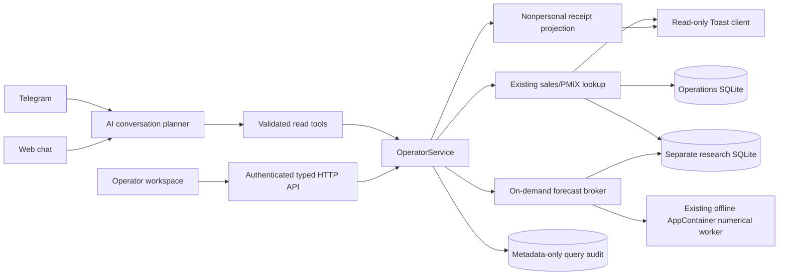

# Tony operator platform

This release extends the existing Windows application. It does not replace Tony,
change vendors, add packages or change background schedules. Source and tests are
complete for the capabilities described below. Production activation remains a
separate backup, migration, restart and verification step.

## Architecture



The current deployment is one process with mandatory Windows locking. SQLite
WAL and indexed date/metric reads are appropriate for one restaurant and its
bounded worker load. Three operator requests can run concurrently. Requests
time out after 120 seconds; subservices have tighter budgets. A busy response is
explicit rather than an unbounded queue. No new Redis, message broker, ORM or
frontend build chain is required. Existing Telegram, 9 AM briefing, research,
weekly imports, coaching, approvals, private guest lookup and memory remain intact.

For multiple independent restaurants, deploy separate data/vault directories and
processes. Sharing one process across tenants is not implemented. A later shared
deployment needs tenant-scoped authentication, Postgres repositories, distributed
job locks and a tested migration strategy; adding web workers alone is unsafe.

## File structure

```text
app/main.py                    Existing app, security middleware and router mounting
app/operations.py              Chat tool orchestration and legacy tool compatibility
app/operator_contracts.py      Discriminated Pydantic contracts and business periods
app/operator_api.py            Versioned HTTP adapter
app/operator_service.py        Query orchestration, concurrency, audit, comparisons
app/operator_forecast.py       Read-only forecast broker, cache, provenance and gaps
app/receipt_lookup.py          Bounded number/UUID receipt lookup
app/order_search.py            Existing bounded amount search and safe projections
app/sales_breakdown.py         Existing dining-option/order-source window totals
app/business_lookup.py         Existing source-separated actuals; observed-day totals
app/corner/                    Existing research schema, calibration and native worker
app/static/operator.js         Accessible forms and escaped result rendering
app/static/operator.css        Responsive workspace layout
app/static/app.js              Existing hash router; staged operator route addition
scripts/validate_operator_release.py  Dry run, exact manifest and native validation
tests/test_operator_workspace.py     Synthetic contract, HTTP, service and forecast tests
OPERATOR-SCHEMA.sql            Additive operations schema
```

## Database design

Existing operations tables remain owned by `app/storage.py` and their domain
modules. They include `meta`, `sessions`, `memory`, `messages`, `briefings`,
`snapshots`, Clover import aggregates, the exception ledger and booking references.
No customer/order payload table is added by this release. Private transcripts
remain bounded DPAPI archives, outside ordinary AI prompt context.

Research remains in `Tonys-Corner/research.sqlite3`, separately migrated by
`app/corner/store.py`: datasets, observations, provenance, journals, hypotheses,
predictions, scorecards, calibrations, runs and experiment records. This release
reads numeric observations but does not issue/backdate scheduled predictions or
modify the research schema.

`OPERATOR-SCHEMA.sql` documents the only new tables. Query audit stores a random
reference, operation kind, timestamps, status, duration and a fixed error code.
It stores no query text, amount filters, results, guest details or model messages.
Keep at most 5,000 completed records. Restart marks abandoned running requests
interrupted. Schema versions newer than this code fail closed. Operations
`PRAGMA user_version` is not repurposed; existing migrations remain intact.

## HTTP API

All routes inherit the existing host allowlist, session authentication, CSRF,
bounded ASGI body reader, no-store headers and restrictive CSP. External vendor
access is read-only. `POST` represents an explicit bounded query and local audit
record, not a POS write.

| Endpoint | Behavior |
|---|---|
| `GET /api/operator/capabilities` | Supported reads, business date/week and limits; no credentials/network calls |
| `GET /api/operator/schema` | Machine-readable discriminated request JSON schema |
| `POST /api/operator/query` | Execute a validated sales/orders/receipt/channels/forecast query |
| `GET /api/operator/queries` | Latest 30 metadata-only query records |

Examples (JSON bodies):

```json
{"kind":"sales","period":"last_week","metric":"sales","compare":"previous_week"}
```
```json
{"kind":"orders","period":"last_14_days","minimum":500,"maximum":900,"basis":"order_total"}
```
```json
{"kind":"receipt","day":"2026-11-03","reference":"101"}
```
```json
{"kind":"channels","day":"2026-11-03","start_hour":16,"end_hour":21}
```
```json
{"kind":"forecast","target":"2026-11-06","metric":"evening_sales"}
```

Custom ranges require `period: "custom"`, `start` and `end`. Extra fields,
inverted ranges, nonfinite money and unsupported metrics fail validation with
HTTP 422. Auth/CSRF failures remain 401/403. Valid requests return an envelope
with `schema_version`, `request_id`, `kind`, `generated_at`, `status`, `error_code`,
`elapsed_ms`, `data`, and `warnings`. Status is complete/partial/unavailable/busy;
a valid HTTP 200 never implies complete business-data coverage. Internal errors
are sanitized; use the request reference for diagnosis.

## Reporting rules

- All periods use the configured business-day cutoff and reporting weekday.
  The restaurant's week is Wednesday–Tuesday. Last 14 days means 14 completed
  business dates; this week ends today and is partial until completed.
- Compare only the same source, metric and complete periods. Clover gross line
  sales and Toast net sales remain separate. A zero prior total has no percentage
  change. Today exposes an observed subtotal, never an invented full-day actual.
- Receipt totals include tax/tip and are not reduced by refunds. Net sales is a
  distinct explicit basis. Split checks retain separate and combined totals.
  Numbers can repeat; ambiguity is shown and customer identity is never inferred.
- Channel results use verified dining behavior and order source, including the
  explicit online-takeout dining option. Unknown classifications remain gaps.
- Whole pizzas exclude slices/calzones/package contents/modifiers. Wings/fingers
  distinguish portions and known pieces. Labor covers recorded Toast hours only.

## Forecasting and UI

The workspace is a responsive form/result layout using existing vanilla JS and
CSS, with semantic labels, live result announcements, escaped text and no inline
scripts or external assets. It provides structured queries without requiring AI
tokens. Chat tools call the same operator service; legacy tools remain available.

Forecasts use stored Toast data from the preceding 449 days, matching the actual
business cutoff and excluding target-day data, future availability and flagged
observations. The existing native worker performs rolling time-based evaluation
with the requested horizon. Results include MAE, WAPE, bias, sample count,
training dates, model/input hashes and an empirical uncertainty interval. There
must be four comparable weekdays and 14 prior calibration residuals; fewer than
28 usable dates or a latest actual older than seven days yields a pending result.
The broker caches identical inputs for five minutes and serializes analysis with
the existing research lock. No unrestricted fallback or new model/search calls.

On-demand estimates are labeled separately from scheduled Corner-issued forecasts.
Existing sports/weather/school context does not become a numeric uplift without
the existing separate evidence/promotion process. Accuracy is measured, not promised.
Historical revised actuals are not true historical point-in-time vintages.

## Validation, activation and rollback

Run `.venv/Scripts/python.exe -m scripts.validate_operator_release` for a no-action
dry run. `--validate` copies the exact candidate into an offline AppContainer,
runs regression tests and denial probes, and writes source hashes/manifest under
`tmp/operator-release-evidence`. Staged UI files are supplied as candidate bytes;
the current served navigation stays unchanged until approved activation.

Before activation: verify candidate hashes, back up operations SQLite through its
backup API into protected storage, test the additive migration on a separate copy,
obtain explicit deployment approval, promote only tested UI bytes, restart through
the existing management route and verify authenticated API/UI and all worker states.
No package, schedule or third-party notification change is included.

Rollback: set `TONY_OPERATOR_DISABLED=1` in local startup configuration and restart
gracefully. The operator router/service stays disabled; legacy tools and all data
remain. Restore the previous staged UI separately if desired. Do not delete audit
tables or overwrite current databases to undo an interface change. Database backup
restoration is a distinct, stopped-service recovery operation requiring approval.

R365 implementation/authorization, live Outlook permission, clean Windows VM setup,
cross-account isolation and multi-tenant deployment remain separate gates. Unit
tests and local Windows isolation do not establish that those gates passed.

