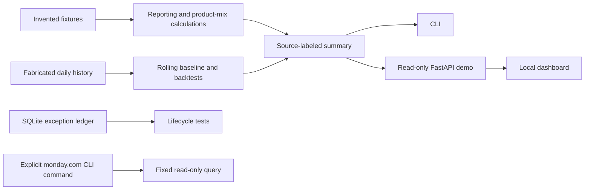

# Tony — Restaurant Operations Intelligence

**Source-aware reporting. Transparent forecasts. Human-approved actions.**

A runnable, privacy-safe portfolio edition of a custom restaurant operations assistant. It demonstrates selected calculation and workflow components from a private operational application, using **invented data only**.

Built by **Matt** · [GitHub profile](https://github.com/Mattcabrices) · Python · FastAPI · SQLite · automated tests

## Why I built it

Restaurant work spans point-of-sale reports, delivery channels, menu quantities, team tasks, events, and incomplete accounting inputs. A helpful assistant has to answer more than “what were sales?” It has to explain **which source, which date, which units, and what is missing**.

I directed the requirements, restaurant workflows, integration decisions, validation, and iterative deployment of the private application, with AI-assisted software development. This public edition shows the engineering approach without publishing a business's records, credentials, recipes, menu mappings, internal procedures, or communications.

## Try it locally

Use Python **3.14.7**. From this repository:

```bash
python -m venv .venv
# Windows PowerShell: .\.venv\Scripts\Activate.ps1
# macOS/Linux: source .venv/bin/activate
python -m pip install --require-hashes --only-binary=:all: -r requirements.lock
python -m tony_demo summary
python -m uvicorn tony_demo.web:create_app --factory --host 127.0.0.1 --port 8789
```

Open [the local dashboard](http://127.0.0.1:8789) or [the API documentation](http://127.0.0.1:8789/docs).

**No live credentials or AI subscription are needed.** The default CLI and dashboard make no external service calls. Keep this demo bound to loopback: it intentionally has no production authentication or write endpoints.

The fixed example contains four invented orders: **$216 sample net sales, five whole pies, four wing portions / 46 wings, and two finger portions / eight pieces**. These are test fixtures, not business claims. The forecast uses a separate 120-day fabricated series; its scores do not establish real-world accuracy.

## What you can inspect

- Decimal-based sales arithmetic, explicit exclusions, duplicate handling, overnight business dates, and DST boundaries.
- Product mix separating order portions from individual pieces. Unknown sizes withhold a complete piece total.
- Explicit top-level pizza identities and channel totals in the synthetic example; no guessed ingredient consumption.
- Same-weekday median forecasts, rolling time-based backtests, MAE, WAPE, bias, and empirical uncertainty ranges. No automatic causal sports/weather uplift.
- A durable SQLite exception ledger with deduplication, acknowledgment, assignment, resolution/reopening, false-positive suppression, optimistic concurrency, and transition history. Exercised through tests; it is not exposed as an unauthenticated web write API.
- A versioned read-only JSON demo contract, optional bounded monday.com read checker, and explicit contracts for future adapters.

## Integrations: implemented, demonstrated, and coming soon

“Private application” describes the source project's implementation; it does **not** mean this public repository includes a configured account or every production feature.

| Integration | Private application's current scope | This public edition |
|---|---|---|
| **Toast** | Read-only sales, items, modifiers, channels, and recorded labor reporting | Synthetic Toast-shaped orders and extracted reporting/product-mix calculations; no live Toast connector |
| **Clover** | Historical imports and inventory-linked item analysis | Source/metric contract and fabricated historical series; no real imports or live Clover connector |
| **monday.com** | Read adapter and manual Excel fallback; live activation awaits a token | Working optional fixed read-only API checker, mocked tests, no credentials included |
| **Outlook** | Bounded read-only Graph Inbox adapter; authorization pending | Contract and roadmap — **coming soon**; no mail access, sending, or drafting in this demo |
| **Google Calendar** | Direct Calendar API is not connected. The private app currently imports a **Google Sheets event calendar** | Direct Calendar connector — **coming soon**; do not confuse Sheets with Calendar API access |
| **Restaurant365** | Provider interfaces only; access pending | Contract and roadmap — **coming soon**; no invoices, inventory, or accounting reads yet |

Telegram delivery, production authentication, encrypted credentials, Windows isolation, and patch approvals remain private deployment components. This demo does not implement them and must not be used to replace that deployment.

## Architecture



See [architecture and trust boundaries](docs/ARCHITECTURE.md), [integration setup](docs/INTEGRATIONS.md), and [release evidence](docs/VALIDATION.md).

## Test and review

```bash
python -m pytest -q
python scripts/check_public_bundle.py
# Optional online check: sends only pinned public package names/versions to OSV
python scripts/audit_dependencies.py
```

CI is configured for Windows and Linux. A workflow file is not proof that a remote CI run has passed; see the validation record for checks actually performed.

[AGENTS.md](AGENTS.md) contains contributor/agent instructions; [agent.md](agent.md) explains the naming convention. Neither file gives an AI agent extra privileges or starts a background process.

## Roadmap

1. Publish additional synthetic fixtures and source-contract tests.
2. Add independently scoped, read-only vendor adapters after access and permissions are confirmed.
3. Add bounded document intake and source-linked catering workflows.
4. Add draft-first email/calendar actions only after exact-content approval and verification design.

Accounting, labor coverage, and forecast quality need reconciliation before real operational decisions. Unavailable data is not zero. Correlation is not causation. An approved proposal is not proof that an external action succeeded.

## Security, license, and attribution

Read [SECURITY.md](SECURITY.md) before adding credentials. No production data, vaults, OAuth sessions, local paths, employee/customer records, real board IDs, or private operational instructions belong in this repository.

MIT license covers this portfolio edition's original code. Third-party packages retain their own licenses. Toast, Clover, monday.com, Microsoft, Google, and Restaurant365 are vendor names; this project is independent and not endorsed by them.
